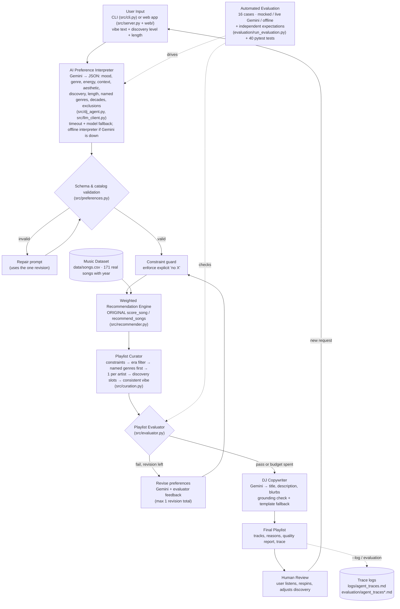

# Soundtrack AI — System Architecture

## System Diagram



## Main Components

| Component | Purpose |
|---|---|
| User Input | Accepts natural-language requests describing a desired music experience. |
| AI Preference Interpreter | Uses an LLM to extract structured preferences such as mood, genre, energy, and context. |
| AI DJ Agent | Coordinates the different steps involved in generating a playlist. |
| Music Dataset | Provides song attributes used by the recommendation algorithm. |
| Weighted Recommendation Engine | Uses the original weighted-scoring algorithm to rank songs based on user preferences. |
| Playlist Curator | Applies constraints, artist diversity, and discovery slots so the playlist keeps one consistent vibe (no forced intro/build/outro arc). |
| Constraint Guard | Deterministically enforces explicit "no X / without X" exclusions the LLM might miss. |
| DJ Copywriter | Uses the LLM to write the title, description, and per-song blurbs; output is checked for grounding. |
| Playlist Evaluator | Checks that recommendations meet quality and reliability requirements. |
| Automated Tests | Tests the system using predefined requests and evaluates recommendation performance. |
| Human Review | Allows users to review playlists and provide feedback. |

## Data Flow

1. The user describes the music experience they want.
2. The LLM interprets the request and extracts structured preferences.
3. The AI DJ Agent coordinates the recommendation process.
4. The weighted recommendation engine ranks songs using the extracted preferences and music dataset.
5. The playlist curator applies constraints, artist diversity, and discovery picks while keeping a consistent vibe.
6. The playlist evaluator checks the results for relevance, diversity, duplicates, and user constraints.
7. If a check fails, the agent gets exactly one controlled revision (repairing malformed JSON, or re-interpreting with evaluator feedback). The better attempt is kept, and any remaining issues are shown to the user.
8. The LLM writes a title, description, and per-song explanations, which are validated against the actual tracks.
9. Automated tests independently evaluate the system using predefined scenarios.

## Human Oversight and Reliability

The system includes both automated and human evaluation.

- **Automated Evaluation:** The Playlist Evaluator checks generated playlists before they are returned to the user. Automated tests measure consistency and recommendation quality across multiple scenarios.
- **Human Evaluation:** Users review generated playlists and determine whether the recommendations match their intended mood and experience.

## Key Design Goals

- Preserve the original weighted-score recommendation algorithm.
- Use an LLM to interpret natural-language music requests.
- Implement an agentic workflow for personalized playlist creation.
- Generate playlists that reflect a desired mood, energy, and listening experience.
- Validate recommendations using automated reliability checks.
- Include human feedback to support future improvements.
```